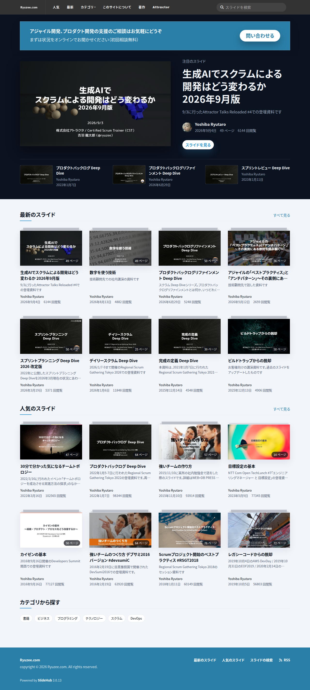

# SlideHub [](https://circleci.com/gh/ryuzee/SlideHub)

**An open source slide sharing application that runs on Azure or AWS.**

If you use or like this project, please give it a star ★. Feedback is always welcome.

SlideHub is built with Ruby on Rails 8.1 and Ruby 3.4. It succeeds an earlier version of SlideHub that was built with CakePHP.



See [another screenshot](docs/images/capture2.png).

## Notice

* v1.7: The paperclip gem was removed, which introduces a small breaking change. Users need to upload their avatar again.

## Features

- Upload slides (PDF only; PowerPoint files are no longer accepted as of v3.0.10)
- Browse slides by category, by user, and more
- View slides in the browser, one page at a time or as a vertical list
- Store slides in Azure Blob Storage or Amazon S3
- Search slides
- Japanese and English user interface
- Responsive design
- Embeddable player
- RSS feeds
- Statistics
- Transcripts (the text of each page)
- API
- Admin dashboard for viewing statistics and editing slides

## Requirements

SlideHub requires the following:

* Docker (you do not need to manage virtual machines such as Azure Virtual Machines or Amazon EC2)
* MySQL 8.4
* AWS or Azure
  * AWS: Amazon S3 and Amazon SQS
  * Azure: Blob Storage and Queue Storage

## Quick start on Azure

To set up SlideHub on Azure with a single script, see [Setting up SlideHub on Azure](docs/azure.md).

## Preparing the cloud resources

### AWS

* Create two Amazon S3 buckets: one for the uploaded files and one for the generated images (e.g. `slidehub-slides` and `slidehub-images`).
* Add the following CORS configuration to the bucket for the uploaded files (Permissions > Cross-origin resource sharing (CORS) in the S3 console).

```json
[
  {
    "AllowedOrigins": ["*"],
    "AllowedMethods": ["GET", "PUT", "POST", "HEAD"],
    "AllowedHeaders": ["*"],
    "ExposeHeaders": ["Access-Control-Allow-Origin"],
    "MaxAgeSeconds": 3000
  }
]
```

* Create an SQS queue (e.g. `slidehub-convert`) and note its URL.

### Azure

* Create two Blob containers: one for the uploaded files and one for the generated images (e.g. `slidehub-slides` and `slidehub-images`).
* Add a CORS rule to the Blob service of the storage account. With the Azure CLI:

```
az storage cors add --services b --methods PUT GET HEAD POST OPTIONS \
  --origins "*" --allowed-headers "*" --exposed-headers "*" --max-age 1800 \
  --account-name YOUR_AZURE_STORAGE_ACCOUNT_NAME
```

* Create a queue in Queue Storage (e.g. `slidehub-convert`) and note its name.

## Preparing the database

SlideHub uses MySQL 8.4. You can run it in any of the following ways:

* Install MySQL on your own server or virtual machine
* Use Amazon RDS for MySQL
* Use Azure Database for MySQL - Flexible Server

Note the following values; you will pass them to the application later:

* Host name of the database server
* User name
* Password

Then create a database for SlideHub. The tables are created by the Rails migrations.

## Getting the Docker image

```
docker pull ryuzee/slidehub:latest
```

## Running the application

The easiest way to run SlideHub is on a container platform such as Amazon ECS, Azure App Service (Web App for Containers), Azure Container Apps, or Kubernetes.

To run it with the `docker` command instead:

```
CONTAINER_ID=$(docker run -d \
  --env SLIDEHUB_REGION=$SLIDEHUB_REGION \
  --env SLIDEHUB_SQS_URL=$SLIDEHUB_SQS_URL \
  --env SLIDEHUB_BUCKET_NAME=$SLIDEHUB_BUCKET_NAME \
  --env SLIDEHUB_IMAGE_BUCKET_NAME=$SLIDEHUB_IMAGE_BUCKET_NAME \
  --env SLIDEHUB_USE_S3_STATIC_HOSTING=$SLIDEHUB_USE_S3_STATIC_HOSTING \
  --env SLIDEHUB_AWS_SECRET_KEY=$SLIDEHUB_AWS_SECRET_KEY \
  --env SLIDEHUB_AWS_ACCESS_ID=$SLIDEHUB_AWS_ACCESS_ID \
  --env SLIDEHUB_USE_AZURE=$SLIDEHUB_USE_AZURE \
  --env SLIDEHUB_AZURE_CONTAINER_NAME=$SLIDEHUB_AZURE_CONTAINER_NAME \
  --env SLIDEHUB_AZURE_IMAGE_CONTAINER_NAME=$SLIDEHUB_AZURE_IMAGE_CONTAINER_NAME \
  --env SLIDEHUB_AZURE_CDN_BASE_URL=$SLIDEHUB_AZURE_CDN_BASE_URL \
  --env SLIDEHUB_AZURE_QUEUE_NAME=$SLIDEHUB_AZURE_QUEUE_NAME \
  --env SLIDEHUB_AZURE_STORAGE_ACCESS_KEY=$SLIDEHUB_AZURE_STORAGE_ACCESS_KEY \
  --env SLIDEHUB_AZURE_STORAGE_ACCOUNT_NAME=$SLIDEHUB_AZURE_STORAGE_ACCOUNT_NAME \
  --env SLIDEHUB_SECRET_KEY_BASE=$SLIDEHUB_SECRET_KEY_BASE \
  --env SLIDEHUB_DB_NAME=$SLIDEHUB_DB_NAME \
  --env SLIDEHUB_DB_USERNAME=$SLIDEHUB_DB_USERNAME \
  --env SLIDEHUB_DB_PASSWORD=$SLIDEHUB_DB_PASSWORD \
  --env SLIDEHUB_DB_URL=$SLIDEHUB_DB_URL \
  --env SLIDEHUB_DB_PORT=$SLIDEHUB_DB_PORT \
  --env SLIDEHUB_SMTP_SERVER=$SLIDEHUB_SMTP_SERVER \
  --env SLIDEHUB_SMTP_PORT=$SLIDEHUB_SMTP_PORT \
  --env SLIDEHUB_SMTP_USERNAME=$SLIDEHUB_SMTP_USERNAME \
  --env SLIDEHUB_SMTP_PASSWORD=$SLIDEHUB_SMTP_PASSWORD \
  --env SLIDEHUB_SMTP_AUTH_METHOD=$SLIDEHUB_SMTP_AUTH_METHOD \
  --env SLIDEHUB_ROOT_URL=$SLIDEHUB_ROOT_URL \
  --env RAILS_LOG_TO_STDOUT=1 \
  --env SLIDEHUB_TIMEZONE=Asia/Tokyo \
  -p 3000:3000 --name slidehub ryuzee/slidehub:latest)
```

Then set up the database:

```
docker exec $CONTAINER_ID bash -l -c 'bundle exec rake db:create RAILS_ENV=production'
docker exec $CONTAINER_ID bash -l -c 'bundle exec rake db:migrate RAILS_ENV=production'
docker exec $CONTAINER_ID bash -l -c 'bundle exec rake db:seed RAILS_ENV=production'
```

### Environment variables

For local testing, the easiest way is to add these variables to `docker-compose.yml`.
In production, set them through your container platform.

**Every variable name must start with `SLIDEHUB_` or `OSS_`.** For example, `SLIDEHUB_DB_NAME` and `OSS_DB_NAME` are the same setting.

#### Cloud settings (Azure)

```
SLIDEHUB_USE_AZURE=[0|1] # Set 1 to use Azure
SLIDEHUB_AZURE_CONTAINER_NAME=[Container for the uploaded files]
SLIDEHUB_AZURE_IMAGE_CONTAINER_NAME=[Container for the generated images]
SLIDEHUB_AZURE_CDN_BASE_URL=[Base URL of your CDN, if you use one]
SLIDEHUB_AZURE_QUEUE_NAME=[Queue name]
SLIDEHUB_AZURE_STORAGE_ACCESS_KEY=[Storage account access key]
SLIDEHUB_AZURE_STORAGE_ACCOUNT_NAME=[Storage account name]
```

#### Cloud settings (AWS)

```
SLIDEHUB_BUCKET_NAME=[Bucket for the uploaded files]
SLIDEHUB_IMAGE_BUCKET_NAME=[Bucket for the generated images]
SLIDEHUB_USE_S3_STATIC_HOSTING=[1|0]
SLIDEHUB_REGION=[ap-northeast-1]
SLIDEHUB_CDN_BASE_URL=[Base URL of your CDN, if you use one]
SLIDEHUB_SQS_URL=[SQS queue URL]
SLIDEHUB_AWS_ACCESS_ID=[AWS access key ID, if the app runs outside AWS]
SLIDEHUB_AWS_SECRET_KEY=[AWS secret access key, if the app runs outside AWS]
```

#### General settings

```
# Rails
RAILS_ENV=[production|development]
RAILS_LOG_TO_STDOUT=[1] # Set to write the logs to standard output

# Required
SLIDEHUB_SECRET_KEY_BASE=[A long random string]

# Time zone
SLIDEHUB_TIMEZONE=[Time zone] # Default: Asia/Tokyo

# Mail
SLIDEHUB_SMTP_SERVER=[SMTP server]
SLIDEHUB_SMTP_PORT=[587]
SLIDEHUB_SMTP_USERNAME=[SMTP user name]
SLIDEHUB_SMTP_PASSWORD=[SMTP password]
SLIDEHUB_SMTP_AUTH_METHOD=plain
SLIDEHUB_FROM_EMAIL=[Sender address of the emails]

SLIDEHUB_ROOT_URL=[https://slides.example.com]
SLIDEHUB_LOGIN_REQUIRED=[1] # Set to require users to log in before viewing any page
SLIDEHUB_HSTS_MAX_AGE=[86400] # In seconds. Sends the Strict-Transport-Security header in production. Set it only if the site is served over HTTPS

# Database for production
SLIDEHUB_DB_NAME=[Database name] # Default: slidehub
SLIDEHUB_DB_USERNAME=[User name]
SLIDEHUB_DB_PASSWORD=[Password]
SLIDEHUB_DB_URL=[Host name of the database server]
SLIDEHUB_DB_PORT=[Port] # Default: 3306
SLIDEHUB_DB_SSL_MODE=[required|disabled] # Default: required (connect over TLS). Set disabled if the server does not support TLS

# Database for development
SLIDEHUB_DB_NAME_DEV=[Database name]
SLIDEHUB_DB_USERNAME_DEV=[User name]
SLIDEHUB_DB_PASSWORD_DEV=[Password]
SLIDEHUB_DB_URL_DEV=[Host name of the database server]
SLIDEHUB_DB_PORT_DEV=[Port]

# Database for tests
SLIDEHUB_DB_NAME_TEST=[Database name]
SLIDEHUB_DB_USERNAME_TEST=[User name]
SLIDEHUB_DB_PASSWORD_TEST=[Password]
SLIDEHUB_DB_URL_TEST=[Host name of the database server]
SLIDEHUB_DB_PORT_TEST=[Port]
```

## Development

### Requirements

- Docker with Docker Compose v2 (the `docker compose` command)

Ruby, Node.js, and all the libraries are included in the development image, so you do not need to install them on your computer.

### Building the image and starting the app

Set the environment variables used in `docker-compose.yml` on your computer, then run:

```
docker compose build
docker compose run --rm app bash -l -c 'bundle exec rake db:create RAILS_ENV=development'
docker compose run --rm app bash -l -c 'bundle exec rake db:migrate RAILS_ENV=development'
docker compose run --rm app bash -l -c 'bundle exec rake db:seed RAILS_ENV=development'

docker compose up -d
```

Gems and JavaScript packages are stored in the `gems` and `node-modules` volumes, so they persist when the container is recreated. The volumes are first filled from the image. After that, run `bundle install` or `yarn install` in the container only when `Gemfile.lock` or `yarn.lock` changes.

### Running the tests

```
docker compose run --rm app bash -l -c 'bundle exec rake db:create RAILS_ENV=test'
docker compose run --rm app bash -l -c 'bundle exec rake db:test:prepare'
docker compose run --rm app bash -l -c 'bundle exec rspec'
```

Tests tagged `js: true` in `spec/system` run in Chrome. Start the Chrome container first; otherwise these tests are skipped.

```
docker compose --profile test up -d chrome
```

To run the slide conversion in the development environment:

```
docker compose run --rm app bash -l -c 'bin/rails runner -e development "require \"./lib/slide_hub/batch\"; SlideHub::Batch.execute"'
```

## Running the conversion batch without Docker

The Docker image runs the conversion batch for you. If you run SlideHub without Docker, install `mupdf-tools`, `poppler-utils`, and ImageMagick, and add the batch to cron.

* Converting uploaded slides (required)

```
*/1 * * * * cd /opt/application/current && bin/rails runner -e production "require \"./lib/slide_hub/batch\"; SlideHub::Batch.execute"
```

## Logging in

The default account is `admin@example.com` with the password `passw0rd`.
*Change this password after you log in for the first time.*

## Running RuboCop and other tools on macOS

You can usually run RuboCop and the other tools in the development container:

```
docker compose exec app bash -l -c 'bundle exec rubocop'
```

To install the gems directly on your Mac, install these dependencies first:

```
brew install imagemagick pkg-config mysql-client
bundle
```

## Contributing

1. Fork the repository on GitHub
2. Create a feature branch (e.g. `add_component_x`)
3. Make your changes
4. Add tests for your changes, if applicable
5. Run the tests and make sure they all pass
6. Open a pull request on GitHub

## License

MIT License
